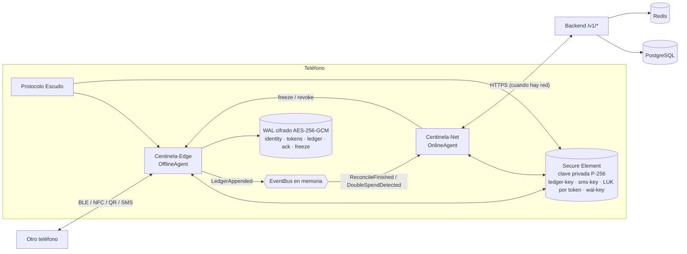
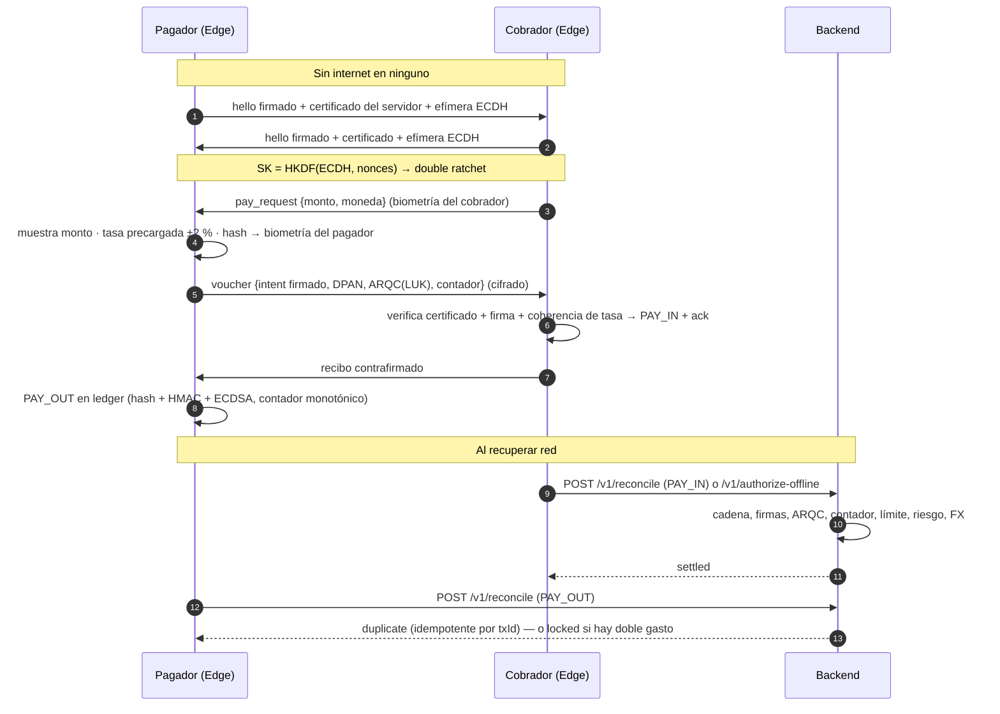

# Arquitectura

SafeWallet Offline es una **capa de seguridad fintech** (SDK + backend) con una billetera offline-first encima.
Resuelve el escenario del documento: pérdida total de conectividad + pérdida del dispositivo + suplantación + préstamos
fraudulentos + extorsión a contactos, y permite pagar sin internet.

```
safewallet-offline/
├── docker-compose.yml        postgres + redis + backend
├── backend/                  Node 22 + TypeScript + Fastify (node:crypto)
│   ├── src/api/              rutas (fuente única de OpenAPI), esquemas JSON, app Fastify
│   ├── src/services/         tokenization · payments (offline-ledger + reconciliation) · panic-protocol · devices (attestation)
│   │                         qr-interop · sms · rates · risk · reports · forensic · tenants
│   ├── src/db/               PostgreSQL (JSONB) · Redis · memoria (tests)
│   └── src/tests/            71 pruebas (unit, integración, contrato OpenAPI)
├── mobile/                   Flutter (Dart) — app + núcleo
│   ├── lib/core/crypto       ECDSA P-256, ECDH, HKDF, AES-256-GCM, double ratchet
│   ├── lib/core/secure_element   abstracción TEE/SE (+ implementación por software simulada)
│   ├── lib/core/dual_agent   offline_agent (Centinela-Edge) · online_agent (Centinela-Net) · bus · WAL cifrado
│   ├── lib/core/panic        Protocolo Escudo, PIN de coacción, señuelo, SOS por SMS, forense, biometría de comportamiento
│   ├── lib/core/integrity    anti-reversa: root/emulador/Frida/Xposed/firma
│   ├── lib/features/         ble_pay · nfc_pay (APDU/HCE) · qr_dynamic · qr_interop · sms_fallback · wallet_guard · multi_currency
│   └── test/                 71 pruebas (incluye integración real contra el backend)
├── docs/  scripts/  LICENSE
```

> Los directorios del documento original usan guiones (`secure-element`, `dual-agent`…). En Dart las rutas de paquetes deben ser
> `snake_case`, por eso aquí son `secure_element`, `dual_agent`, `ble_pay`, etc. `nfc_pay` vive dentro de `ble_pay/transport.dart`
> (`NfcApdu`) porque comparte el mismo protocolo seguro sobre un transporte distinto.

## Doble agente (Centinela-Net ↔ Centinela-Edge)



* **Edge** (siempre disponible): valida y emite pagos, aplica los **límites duros** offline (diario, por operación, por país,
  comercio fuera de lista blanca ÷4, riesgo > 70 ⇒ biometría + PIN + prueba SMS) y registra cada operación en el **ledger firmado**.
* **Net** (cuando hay red): attestation, tokenización, precarga de tasas, comandos remotos (`SE_WIPE`, `FREEZE_LEDGER`), **replay del WAL**
  y conciliación. Si hay conflicto (doble gasto, ledger manipulado, límite excedido) el backend bloquea (`locked`) y Net congela a Edge y
  notifica (`DoubleSpendDetected`).
* **Bus**: cola de eventos en memoria; el estado durable vive en el WAL cifrado (cada registro autentica su índice como AAD).

## Flujo de pago offline y conciliación



## Canales de pago

| Canal | Módulo | Qué es real | Qué requiere hardware |
|---|---|---|---|
| Bluetooth LE | `features/ble_pay` | handshake autenticado, double ratchet, fragmentación MTU+CRC, biometría en ambos lados | binding GATT (plugin BLE) |
| NFC / HCE | `features/ble_pay/transport.dart` (`NfcApdu`) | APDU ISO 7816: SELECT AID + comandos encadenados, mismo protocolo seguro | servicio HCE nativo (Android) / CoreNFC |
| QR dinámico | `features/qr_dynamic` + `POST /v1/qr/dynamic` | firma del servidor verificable offline, tasa pactada, un solo uso, QR de respuesta | cámara |
| QR EMVCo (Yape/Plin) | `features/qr_interop` + `/v1/qr/emv/*` | parser TLV + CRC16, detección de billetera, voucher diferido, enrutamiento | pasarela real (Niubiz/Izipay/billetera) — aquí mock |
| Contacto → SMS | `features/sms_fallback` | `SWPAY1`: deflate + AES-256-GCM (≤ 3 SMS) | telefonía nativa para enviar |
| Google Pay / Apple Pay | `features/wallet_guard` + `/v1/wallets/provision` | Wallet Guard intercepta y valida; tokens de TTL extendido | emisor/TSP certificado y entitlements |

## Datos

PostgreSQL: una tabla `documents(col,id,doc JSONB)` con índice GIN (colecciones: `devices`, `tokens`, `txs`, `counters`, `profiles`, `log:*`…).
`insert()` es atómico (`ON CONFLICT DO NOTHING`) y respalda la idempotencia y la detección de doble gasto.
Redis: rate limit por plan, challenges/nonces de un solo uso, locks distribuidos, anti fuerza bruta de PIN.
